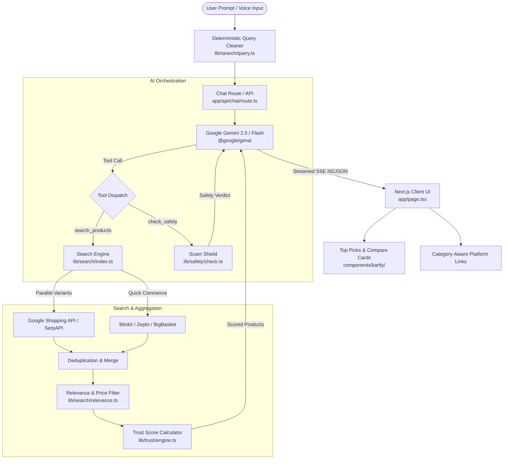

<div align="center">

# 🛒 Kartly — AI Shopping Assistant

**The intelligent shopping companion that searches across Indian e-commerce & quick-commerce platforms, verifies seller credibility, and finds the safest best deals.**

[](https://kartly-prompt-eng.vercel.app)
[](https://nextjs.org/)
[](https://www.typescriptlang.org/)
[](https://ai.google.dev/)
[](https://tailwindcss.com/)
[](LICENSE)

[**Explore Live Demo »**](https://kartly-prompt-eng.vercel.app) · [Report Bug](https://github.com/vikash111-vickey/kartly-prompt-eng/issues) · [Request Feature](https://github.com/vikash111-vickey/kartly-prompt-eng/issues)

</div>

---

## 🌟 Overview

Shopping online across multiple apps in India often means juggling dozens of tabs between Amazon, Flipkart, Croma, Blinkit, and Zepto, dealing with fake discount traps, unverified third-party sellers, and confusing delivery charges.

**Kartly** solves this by acting as your personal AI shopping concierge:
- It understands natural queries in **English, Hindi, and Tamil** (e.g. *"am liking to buy a new study chair for study under 3000"*, *"3000 के अंदर अच्छा ईयरबड्स"*, *"நல்ல மொபைல் ₹15000 க்குள்"*).
- Aggregates verified listings across leading Indian e-commerce and quick-commerce stores.
- Computes a proprietary **0–100 Trust Score** factoring in review authenticity, seller rating, and median market pricing.
- Provides a built-in **Scam Checker** to inspect suspicious seller links, advance payment requests, and fraudulent SMS messages.
- Always redirects directly to official store checkouts with zero intermediary payment handling.

---

## 🚀 Key Features

### 🔍 1. Multi-Platform Search & Aggregation
- **E-Commerce Giants**: Amazon India, Flipkart, Croma, Reliance Digital, Tata CLiQ, Myntra, Meesho, Snapdeal.
- **Quick-Commerce**: Blinkit, Zepto, BigBasket (for instant 10–15 minute grocery & essential deliveries).
- **Dual Query Variants**: Automatically runs complementary query variants in parallel to maximize catalog coverage while deduplicating identical listings.

### 🛡️ 2. Dynamic Trust Score Engine (0–100)
Every product card is transparently evaluated across critical confidence factors:
- **Review Volume & Quality**: Penalizes high star ratings backed by only 2–3 reviews.
- **Price Anomaly Detection**: Flags deals priced suspiciously below market median (>40% below typical price).
- **Seller Verification**: Confirms verified merchant status vs. unverified new storefronts.
- **Transparent Breakdown**: Click *"Why this score?"* on any card to see individual factor bars, positive highlights, and potential red flags.
- **Confidence Calibration**: Sparse listings with low data automatically receive a neutral *"Limited data"* tag rather than a misleading grade.

### 🧠 3. Advanced Gemini AI Multi-Turn Orchestration
- Powered by `@google/genai` with continuous fallback across `gemini-2.5-flash`, `gemini-3.5-flash-lite`, and `gemini-3-flash-preview`.
- **Function Calling Tools**:
  - `search_products`: Executes structured parametric searches (category, max budget, urgency, exclusions).
  - `check_safety`: Inspects pasted URLs, homograph attacks, and UPI advance fee scam patterns.
- **Resilient Multi-Turn Protocol**: Strict turn alternation, automatic role bundling, and 30-minute quota circuit breakers.

### 🧹 4. Deterministic Multilingual Query Normalizer
- Extracts genuine product intent and budget thresholds from conversational sentences.
- Strips filler expressions (`"i want to buy"`, `"looking for"`, `"can you please show me"`, `"for me"`, `"in 10 minutes"`).
- Parses currency and budget limits in English (`"under 3000"`), Hindi (`"3000 के अंदर"`), and Tamil (`"₹15000 க்குள்"`).

### 🔒 5. Built-in Scam & Link Shield
- Inspects user-submitted links against strict domain allowlists (`amazon.in`, `flipkart.com`, `croma.com`, `myntra.com`, etc.).
- Flags raw IP hostnames, URL shorteners (`bit.ly`, `tinyurl.com`), and typosquatting domains (e.g., `amaz0n-offers.in`, `amazon.in.evil.com`).
- Detects fraudulent patterns such as OTP solicitation and advance payment to personal UPI handles.

### 🎨 6. Minimalist, Accessible Design
- Clean, focused interface adhering to strict accessibility and design guidelines.
- Fluid animations with **Framer Motion** (with full support for `prefers-reduced-motion`).
- Web Speech API integration supporting 8 Indian language voice inputs (English, Hindi, Tamil, Telugu, Kannada, Malayalam, Bengali, Marathi).
- Fully responsive across mobile, tablet, and desktop screens with safe-area and dynamic viewport (`dvh`) units.

---

## 🏗️ Architecture



---

## 💻 Tech Stack

| Layer | Technology | Description |
| :--- | :--- | :--- |
| **Framework** | [Next.js 16 (App Router)](https://nextjs.org/) | Turbopack, Server-Sent Events (SSE), Server Components |
| **Language** | [TypeScript 5](https://www.typescriptlang.org/) | Strict typing, zero implicit any, full Zod runtime schemas |
| **Styling** | [Tailwind CSS v4](https://tailwindcss.com/) | Modern utility-first CSS, dynamic color scales, CSS variables |
| **Components** | [shadcn/ui](https://ui.shadcn.com/) + Lucide | Headless accessible components and clean iconography |
| **AI Model** | [Google Gemini 2.5](https://ai.google.dev/) | Multi-turn reasoning, native function calling, quota recovery |
| **Animations** | [Framer Motion](https://www.framer.com/motion/) | GPU-accelerated micro-interactions, layout transitions |
| **Validation** | [Zod](https://zod.dev/) | Runtime request parsing, streaming event type safety |
| **Markdown** | [React-Markdown](https://github.com/remarkjs/react-markdown) | Safe sanitized assistant rendering (no raw HTML) |
| **Deployment** | [Vercel](https://vercel.com/) | Global Edge/Serverless deployment with 60s execution budget |

---

## 📂 Project Structure

```
├── app/
│   ├── api/
│   │   ├── chat/route.ts      # Multi-turn streaming chat endpoint with tool loops
│   │   ├── health/route.ts    # Service & model health check endpoint
│   │   └── search/route.ts    # Direct search endpoint
│   ├── layout.tsx             # Root layout with Noto Sans & Geist font loaders
│   ├── page.tsx               # Main shopping app shell & stream orchestrator
│   └── globals.css            # Tailwind CSS styling and theme configuration
├── components/
│   ├── kartly/
│   │   ├── hero.tsx           # Initial hero with rotating placeholders & voice mic
│   │   ├── ask-input.tsx      # Pill search bar with Web Speech language picker
│   │   ├── chat-view.tsx      # Multi-turn conversation view & "More stores" row
│   │   ├── product-card.tsx   # Verified product card with ratings & trust score
│   │   ├── trust-badge.tsx    # Interactive "Why this score?" factor breakdown
│   │   ├── compare-drawer.tsx # Side-by-side spec comparison drawer (up to 3 items)
│   │   └── wishlist.tsx       # LocalStorage-persisted saved items drawer
│   └── ui/                    # Reusable shadcn/ui components (dialog, badge, etc.)
├── lib/
│   ├── gemini.ts              # Gemini client factory, model fallback & error classifier
│   ├── gemini-tools.ts        # Function calling declarations & schema definitions
│   ├── links.ts               # Domain allowlist validator & search link builders
│   ├── safety/
│   │   └── check.ts           # Anti-scam, phishing, and URL security engine
│   ├── search/
│   │   ├── index.ts           # Parallel 2-variant search aggregator & 10m cache
│   │   ├── query.ts           # Multilingual deterministic query & budget cleaner
│   │   ├── relevance.ts       # Accessory filter (12% rule) & exclusion matcher
│   │   └── mock.ts            # Offline fallback dataset for local testing
│   └── trust/
│       └── engine.ts          # 0-100 Trust Score scoring algorithm
├── scripts/
│   ├── test-query.ts          # Deterministic query cleaner offline test suite
│   ├── test-trust.ts          # Trust Score engine unit tests (7 test groups)
│   ├── test-cost.ts           # Total cost calculation unit tests (5 test cases)
│   └── test-safety.ts         # Scam detection test suite (14 test cases)
└── types/
    └── product.ts             # Core domain TypeScript interfaces
```

---

## 🛠️ Getting Started

### Prerequisites
- **Node.js**: v20.x or higher
- **npm** / **pnpm** / **yarn**
- **Google Gemini API Key**: Obtain a free API key from [Google AI Studio](https://aistudio.google.com/)
- *(Optional)* **SerpAPI Key**: Obtain from [SerpAPI](https://serpapi.com/) for live Google Shopping searches (if omitted, Kartly seamlessly uses its rich offline mock catalog)

### 1. Clone & Install

```bash
# Clone the repository
git clone https://github.com/vikash111-vickey/kartly-prompt-eng.git
cd kartly-prompt-eng

# Install dependencies
npm install
```

### 2. Environment Configuration

Create a `.env.local` file in the root directory:

```env
# Google Gemini API Key (Required for live AI reasoning)
GEMINI_API_KEY=your_gemini_api_key_here

# Active Gemini Model (Optional, defaults to gemini-2.5-flash)
GEMINI_MODEL=gemini-2.5-flash

# Fallback models tried if quota or overload occurs
GEMINI_FALLBACK_MODELS=gemini-3.5-flash-lite,gemini-3-flash-preview

# SerpAPI Key (Optional: for live Google Shopping scraping)
SERPAPI_KEY=your_serpapi_key_here

# Enable mock search if you want to test fully offline
USE_MOCK_SEARCH=false
```

### 3. Run Development Server

```bash
npm run dev
```

Open [http://localhost:3000](http://localhost:3000) in your browser.

---

## 🧪 Offline Test Suites

Kartly includes comprehensive standalone unit test suites that run 100% offline without consuming API credits:

```bash
# 1. Test Query Cleaner (English, Hindi, and Tamil phrases)
npx tsx scripts/test-query.ts

# 2. Test Trust Score Engine (review thresholds, price anomalies, ratings)
npx tsx scripts/test-trust.ts

# 3. Test Cost Engine (delivery calculations & fee confirmations)
npx tsx scripts/test-cost.ts

# 4. Test Scam Checker (phishing, advance fee fraud, OTP solicitations)
npx tsx scripts/test-safety.ts
```

All 4 test suites exit with code `0` on success.

---

## 🚀 Production Build & Deployment

To verify the production build locally:

```bash
npm run lint
npm run build
```

### Deploying to Vercel

Kartly is optimized for 1-click deployment on **Vercel**:

1. Push your code to your GitHub repository.
2. Import the repository in [Vercel Dashboard](https://vercel.com/new).
3. Under **Environment Variables**, configure:
   - `GEMINI_API_KEY`
   - `SERPAPI_KEY` *(optional)*
4. Click **Deploy**. Vercel will build and serve your app globally on Edge/Serverless infrastructure.

---

## 🔐 Security & Privacy Policy

- **No Payment Details Ever Requested**: Kartly never asks for, processes, or stores debit/credit cards, UPI PINs, or bank credentials.
- **Strict Domain Whitelist**: Product links and platform chips are strictly validated against an allowlist of official merchant domains (`amazon.in`, `flipkart.com`, `croma.com`, `tatacliq.com`, `myntra.com`, `blinkit.com`, `zeptonow.com`, `bigbasket.com`).
- **Phishing Protection**: Suspicious links, shorteners, and raw IP hostnames are flagged and blocked from rendering as active buy buttons.
- **Client-Side Wishlist**: Wishlists are stored entirely in local browser `localStorage`, ensuring zero user profile tracking.

---

## 📄 License

This project is licensed under the [MIT License](LICENSE).

---

<div align="center">

Made with ❤️ for smart, safe shopping in India.

[**Back to Top ↑**](#-kartly--ai-shopping-assistant)

</div>
